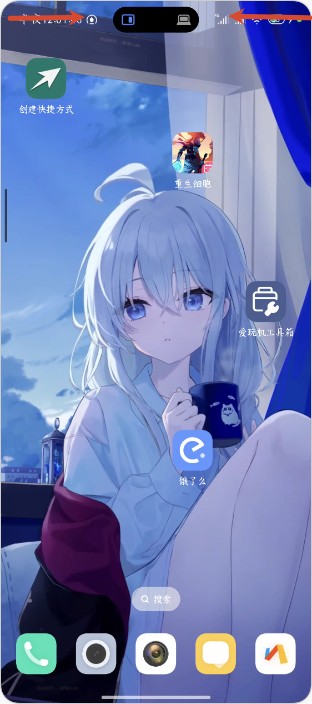
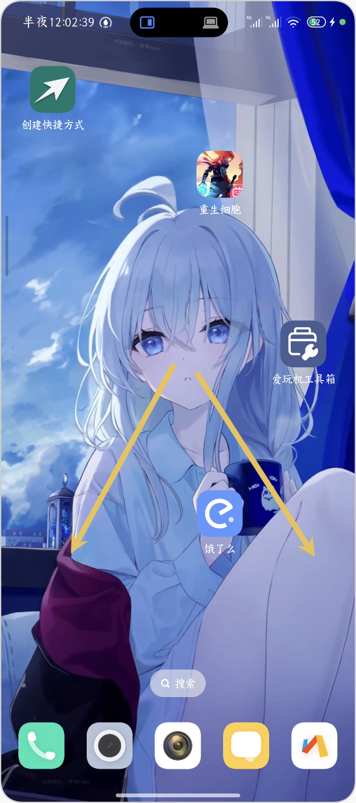
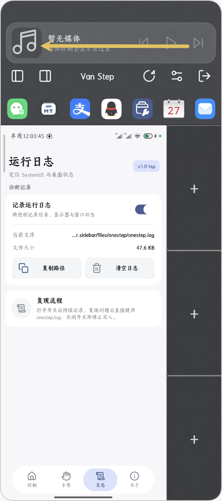
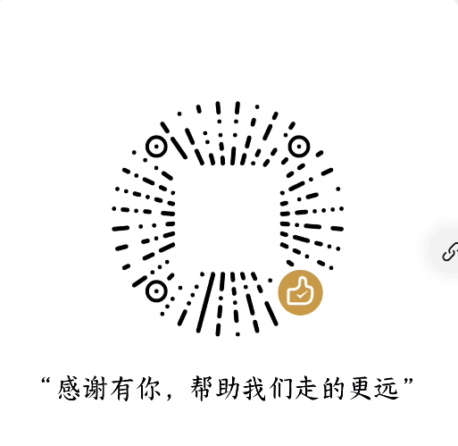

# Van Step

> 将 SmartisanOS 的 **One Step** 侧边栏体验以**独立 App + Root 桥**的形式带入 HyperOS；可选 LSPosed 增强包恢复系统级效果。

[](#环境要求)
[](#环境要求)
[](#安装)
[](https://github.com/LSPosed/LSPosed)
[](LICENSE)

Smartisan OS 已经远去，但它最好的创意不应被遗忘。Van Step 在现代小米 HyperOS 之上还原了 One Step 侧边栏——将任何内容拖拽到任何地方。：主 App 通过 Root 桥（KSU/Magisk 拉起的 `app_process` 守护进程）完成窗口与任务管理；，可恢复状态栏变换、全局手势接管等需要进程内 Hook 的系统级体验。

## 功能

### 侧边栏

从屏幕边缘滑入，即可查看最近的图片、文件和剪贴板历史。将条目拖拽到应用图标上即可分享，或拖拽到窗口槽位即可在其中打开。

- **最近图片 / 文件 / 剪贴板**，Smartisan三大区，原汁原味
- **拖拽分享**至应用快捷方式，每次命中时提供触觉反馈
- **媒体控制**位于顶部栏，重新打开时定位到你上次使用的页面
- **任务切换**和自由窗口控制，包括主/副分屏互换

### HyperDrag

由**[HyperdragShare](https://github.com/Leaf-lsgtky/HyperDragShare)** 提供的分词拖拽功能，支持从绝大部分app拖拽提取识别到任意应用窗口中，并支持拖拽过程中预览。

### 手势触发方式

| 触发方式 | 工作原理 |
| --- | --- |
| 通知栏磁贴 | `OneStepTileService` 点击 → 发 `ACTION_TOGGLE_ONE_STEP` 广播 |
| 状态栏水平向内滑 | 顶部 overlay 热区判定：左半屏右滑 / 右半屏左滑（对侧映射开对侧小窗） |
| 左右侧边条内滑 | 可选入口，与状态栏手势同一套判定，同样按对侧映射 |
| 热区长按 | 路由到 `BigBangBridge`（默认 no-op，等待后续 BigBang 项目接入） |
| 角落 / 边缘滑动（增强包） | 安装 LSPosed 增强包后可切换为无 overlay 的全局手势 |

模块设置中提供按应用黑名单和可调节的长按时长。

## 环境要求

- Android 15 – 16（`minSdk 33`，`targetSdk 36`）
- HyperOS  2.0 / 3.0（已在小米 15 Pro、 和 K40 上测试）
- Root 权限（Magisk / KernelSU / APatch）——Root 桥守护进程、持久化设置均需要
- 可选：[LSPosed](https://github.com/LSPosed/LSPosed)（仅当需要安装 LSPosed 增强包以恢复系统级 Hook 效果时）
！！！在使用前请备份数据 硬盘有价 数据无价！！！
## 安装

1. 安装 Van Step 主 APK（`com.hyper.onestep`），并刷入 KSU/Magisk 模块以拉起 Root 桥守护进程。模块同时把内置锤子桌面（`com.smartisanos.home`）作为系统应用挂载到 `/system/app/SmartisanHome`，工作区的"嵌入桌面"默认选择"内置-锤子桌面"，无需再走数据分区安装。
2. 在 Root 管理器中授予本应用 **Root 权限**。设置通过 `su` 写入，如果没有 Root 权限，所有开关都会静默回退。
3. （可选）安装 LSPosed 增强包  并在 LSPosed 中启用（作用域：`系统框架` / `系统界面` / `启动器`），重启后恢复状态栏变换、全局手势接管等系统级体验。未安装增强包时上述能力自动降级为 no-op，不影响基础使用。

### 活动调用
su -c 'am broadcast -a com.hyper.sidebar.ACTION_OFF_ONE_STEP'
su -c 'am broadcast -a com.hyper.sidebar.ACTION_ON_ONE_STEP'
su -c 'am broadcast -a com.hyper.sidebar.ACTION_TOGGLE_ONE_STEP'
## 构建

```sh
./gradlew assembleDebug

```

需要 JDK 21。Gradle 8.7 会拒绝 JDK 24 并报 `Unsupported class file major version 68` 错误，因此如果你的默认 JVM 是 JDK 24，请将构建指向其他版本：

```sh
JAVA_HOME="/path/to/jdk-21" ./gradlew assembleDebug

```

## 项目结构

| 路径 | 内容 |
| --- | --- |
| `src/` | 侧边栏 UI、数据管理器与全部任务/窗口逻辑（运行于主 App 进程） |
| `src-stubs/` | AOSP 中不存在的 SmartisanOS 框架类的桩代码 |
| `lsp-enhance/` | 可选 LSPosed 增强包（独立 APK `com.hyper.onestep.enhance`，SystemUI / system_server / miui.home 三作用域 Hook） |
| `zygisk/` | Zygisk 原生注入模块（图片拖拽、状态栏等 Hook 的载体） |
| `packaging/` | KSU/Magisk 模块模板（customize.sh / service.sh / post-fs-data.sh 等）与内置锤子桌面 APK 源料 |
| `scripts/` | Zygisk 编译、状态栏 overlay 与 KSU/Magisk 发行包打包脚本 |
| `smartisan-launcher-maintained/` | 内置锤子桌面（`com.smartisanos.home`）的 smali 反编译维护工程 |
| `res/` | 布局、绘图资源和字符串 |

## 致谢

**Smartisan Technology（锤子科技）**——感谢 One Step 和 BigBang，以及将它们开源。本项目是 [SmartisanTech/packages_apps_OneStep](https://github.com/SmartisanTech/packages_apps_OneStep) 的移植版本（上游以 Apache License 2.0 发布）；本仓库在其基础上继续开发，并依 Apache-2.0 与 GPL-3.0 的兼容条款，将本项目以 **GPL-3.0** 发布。这里每一个值得称道的交互都是他们的原创；本仓库所做的工作，主要是让这些创意在别人的 ROM 上跑起来。

**BigBang 团队**，其原版 `com.smartisanos.textboom` 构建提供了精确的动画时序、碎片颜色和窗口参数。
**[HyperdragShare](https://github.com/Leaf-lsgtky/HyperDragShare)**，其分词拖拽功能提供了从绝大部分app拖拽提取识别到任意应用窗口中，并支持拖拽过程中预览。
**[LSPosed](https://github.com/LSPosed/LSPosed)** 和 [libxposed](https://github.com/libxposed/api) 的作者们——可选增强包仍基于该框架实现进程内 Hook。
**[Onestep4](https://github.com/SangLuoCN/OneStep4)**，提供思路支持
**[smartisan-launcher-maintained](https://github.com/rianlu/smartisan-launcher-maintained)**，提供锤子桌面源码支持内置锤子桌面还原启动器体验
**[Lucide](https://lucide.dev)** 提供的图标集。完整声明见 [THIRD_PARTY_NOTICES.md](THIRD_PARTY_NOTICES.md)。

**[Miuix](https://github.com/compose-miuix-ui/miuix)**（compose-miuix-ui）——设置页面的 Compose UI 框架与主题组件基座。

**[SukiSU-Ultra](https://github.com/SukiSU-Ultra/SukiSU-Ultra)**，其 Miuix 风格的管理界面是本模块设置页面的参考——悬浮胶囊底部栏、色调卡片和状态标签均是其 Compose 组件的 View 层移植。其液态玻璃效果则基于 [Kyant0/AndroidLiquidGlass](https://github.com/Kyant0/AndroidLiquidGlass)。


### 遇到问题
1. **Root 桥未就绪**：确认已刷入 KSU/Magisk 模块并重启；查看日志中 `RootBridgeManager` 的 `bridge ready` 行。
2. **权限不足**：检查 Root 管理器是否已授予本应用 **Root 权限**。
3. **触控守护进程未启动**：检查守护进程是否已安装并启动。如果未启动，请参考 [触控守护进程](#触控守护进程)。
4. **增强包能力未生效**：确认已安装 `com.hyper.onestep.enhance` 并在 LSPosed 中勾选作用域后重启。
5. **系统版本不兼容**：本应用仅支持 Android 15 – 16，请确保您的设备运行的是兼容的 Android 版本。
6. 自行无法解决的问题 请提交issue至[https://github.com/LAOBILAXI233/onestep_on_hyper](https://github.com/LAOBILAXI233/onestep_on_hyper)
   提交的issus应该包括但不限于:
   1. 系统版本
   2. HyperOS版本
   3. LSPosed版本（若安装增强包）
   4. 出现问题的具体操作
   5. 出现问题的具体描述
   6. 出现问题的具体截图
   7. 出现问题的具体日志
   日志的获取方式:/data/data/com.hyper.onestep/files/onestep/onestep.log
### 手势操作
1. **onestep启动**：点击通知栏磁贴，或从状态栏边缘水平向内滑动（左半屏右滑 / 右半屏左滑），即可打开侧边栏。在侧边栏中，你可以查看最近的图片、文件和剪贴板历史，并将条目拖拽到应用图标上即可分享，或拖拽到窗口槽位即可在其中打开。
2. **嵌入桌面**：进入 Van Step 后，在主区上滑（Home 手势）即可唤出嵌入的桌面启动器；点开 app 会直接成为主区任务，退出 Van Step 则无缝回到真实桌面。
3. **媒体控制**：在侧边栏的顶部栏，你可以找到媒体控制按钮，包括播放、暂停、上一首、下一首等操作。
4.媒体控制与近期图片、文件、剪贴板历史切换 向左滑动解锁三大金刚键（bushi）

## 贡献
如果你有更好的想法，欢迎提交 Pull Request 或 Issue。
欢迎提交 Pull Request 或 Issue。

# 可以给我点个star吗？:)


# 贡献者名单
感谢各位贡献者对本项目的支持与贡献！能让我们走的更远
## 许可证

**GPL-3.0**——详见 [LICENSE](LICENSE)。本项目基于 Apache-2.0 许可的 Smartisan OneStep 移植，依 Apache-2.0 与 GPL-3.0 的兼容条款以 GPL-3.0 继续发布；第三方组件（Miuix、Lucide、LSPosed 等）各自遵循其原始许可证，详见 [THIRD_PARTY_NOTICES.md](THIRD_PARTY_NOTICES.md)。
## Buy me a coffee
如果你觉得这个项目对你有帮助，欢迎请我喝杯咖啡。
